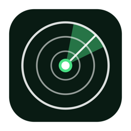
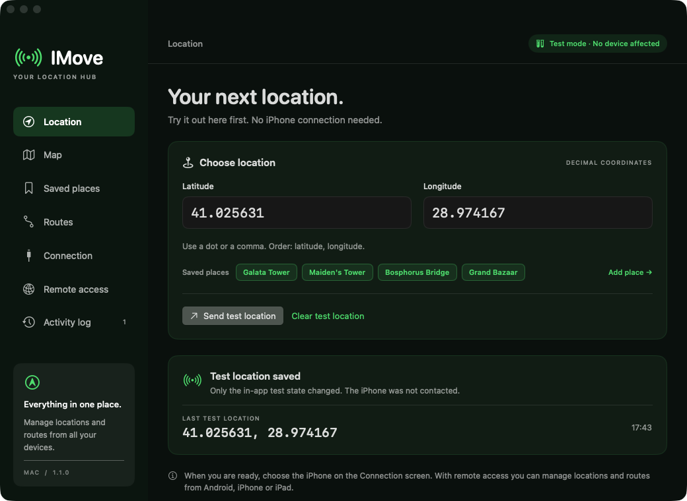
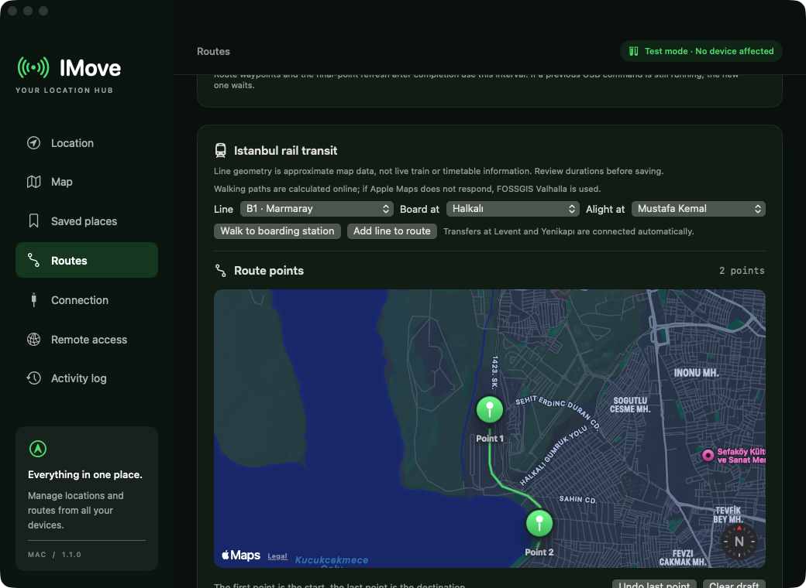
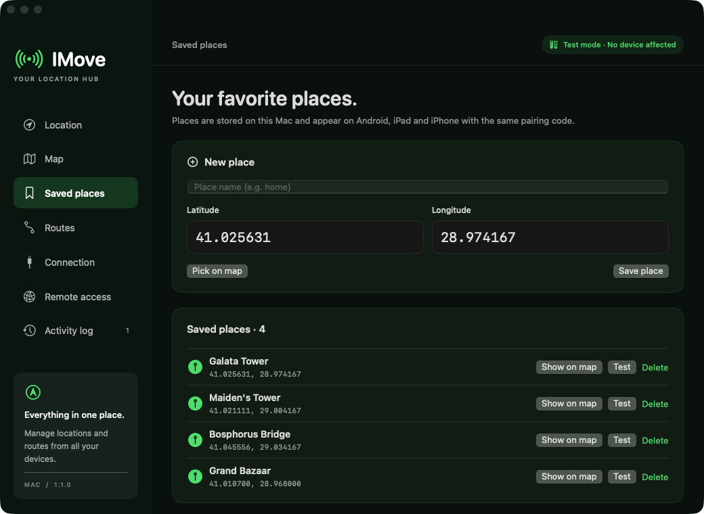

<p align="center">
  
</p>

<h1 align="center">IMove</h1>

<p align="center">
  Control the simulated location of a USB-connected iPhone from your Mac —<br>
  and send locations, saved places and routes from Mac, Android, iPhone/iPad or the web.
</p>

<p align="center">
  <a href="https://aehoradesum.github.io/IMove/"><b>Website</b></a> ·
  <a href="https://github.com/AehoraDeSum/IMove/releases/latest"><b>Download</b></a> ·
  <a href="macos/Guide.html"><b>User guide</b></a>
</p>

<p align="center">
  
  
  
  
  
  
</p>

<p align="center">
  
</p>

---

## How it works

```
Android / iPhone / iPad / Web  ──(Tailscale Serve, private HTTPS)──▶  IMove on Mac  ──(USB)──▶  target iPhone
```

The Mac app sends location commands to the iPhone connected over USB through a bundled [pymobiledevice3](https://github.com/doronz88/pymobiledevice3) tool. The same Mac serves a small control API and web interface on a private network; other devices connect with a 32-character pairing code.

## Features

- **Send a location** — type a coordinate or pick one on the map, with a fixed USB refresh interval of 1–60 seconds.
- **Saved places** — one list stored on the Mac and shared by every client as one-tap shortcuts.
- **Routes** — any number of stops, per-segment minutes/seconds or an evenly split total, and waypoints to reshape each segment.
- **Walking paths** — Apple Maps pedestrian routing, with FOSSGIS Valhalla as a fallback.
- **Istanbul rail** — B1 Marmaray, M2 and M6 stations and transfers, bundled as an offline catalogue.
- **Tracking** — relay an Android or iOS device's real location to the Mac about every five minutes.
- **Security** — pairing codes are kept in the Android Keystore / iOS Keychain, traffic stays on a private Tailscale network (no Funnel), and the HTTP server is bounded, single-request and uses constant-time code comparison.
- **Test mode** — try everything in the Mac app without touching a physical device.

## Screenshots

<p align="center">
  
  
</p>

## Repository layout

| Folder | Contents | Stack |
|---|---|---|
| [`macos/`](macos) | Main Mac app, USB bridge, remote control server and web interface | Swift / SwiftUI, SwiftPM, Leaflet |
| [`android/`](android) | Android remote control app | Java, Gradle |
| [`ios/`](ios) | iPhone and iPad remote control app | SwiftUI, MapKit |
| [`ios-probe/`](ios-probe) | Experimental iPhone tool that reports Core Location readings to the Mac | SwiftUI |
| [`docs/`](docs) | Project website, device ecosystem notes, images | HTML |

## Quick start

Prebuilt packages are on the [Releases](https://github.com/AehoraDeSum/IMove/releases) page.

### Mac

1. Unzip `IMove-1.1.0-macOS-arm64.zip` and move **IMove.app** to your Applications folder.
2. Connect the iPhone over USB and unlock it; scan for and select it on the **Connection** screen. Mount the developer image if asked.
3. For remote access, choose **Remote access → Start control page**, then run:

   ```bash
   tailscale serve --bg 8765
   ```

### Android

Install `IMove-1.1.0-Android.apk`, then enter the Mac's `https://…ts.net` address and the pairing code on the **Connection** screen.

### iPhone / iPad

Open `ios/IMoveMobile.xcodeproj` in Xcode, choose your own development team and **Run** on your device. Details: [ios/README.md](ios/README.md).

The full user guide is in [macos/Guide.html](macos/Guide.html).

## Building from source

**Mac** (Apple Silicon, Xcode Command Line Tools, Python 3.13):

```bash
cd macos
./BuildUSB.command   # builds the bundled USB tool (needs internet the first time)
./Build.command      # builds IMove.app
./Test.command       # runs the 47 logic tests
```

**Android** (JDK 17+, Android SDK 36):

```bash
cd android
./gradlew assembleDebug
```

**iOS**: open `ios/IMoveMobile.xcodeproj` in Xcode → choose a device → Run.

## Notes and limitations

- A normally signed iOS app cannot change the system location of the device it runs on; only the iPhone connected to the Mac over USB is affected. See [docs/DEVICE_ECOSYSTEM.md](docs/DEVICE_ECOSYSTEM.md).
- Rail line geometry is approximate and contains no real-time service data.
- When a walking path is calculated, the coordinates are sent to Apple Maps and, if needed, to the FOSSGIS Valhalla demo service.
- This is a personal project built for development and testing.

## Third-party

- [Leaflet](https://leafletjs.com) — BSD-2-Clause ([license](macos/Web/LEAFLET-LICENSE.txt))
- [pymobiledevice3](https://github.com/doronz88/pymobiledevice3) — downloaded at build time
- Map data © [OpenStreetMap](https://www.openstreetmap.org/copyright) contributors

## License

IMove is licensed under the [GNU General Public License v3.0](LICENSE).
